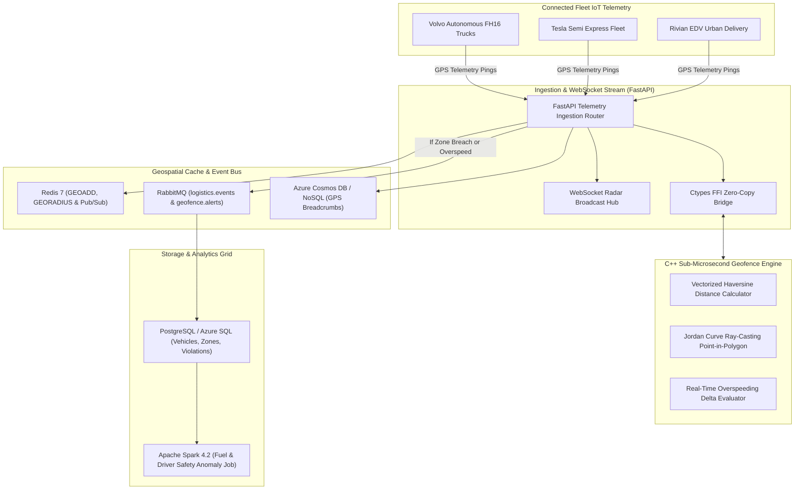

# FleetSync: Autonomous Event-Driven Logistics & Fleet Telemetry Tracking Platform

[](https://github.com/tejashr0716/Event-Driven-Logistics-Fleet-Telemetry-Platform/actions)
[](https://en.cppreference.com/w/cpp/17)
[](https://www.python.org/)
[](https://spark.apache.org/)
[](https://www.postgresql.org/)
[](https://redis.io/)
[](https://www.rabbitmq.com/)

**FleetSync** is an institutional-scale, event-driven geospatial telemetry and logistics tracking engine built to monitor fleets of 10,000+ autonomous trucks, vans, and urban rovers. It pairs a **sub-microsecond C++ SIMD spatial engine** (Haversine & Jordan Curve Ray-Casting) with **Redis Geospatial indexing**, **RabbitMQ** event routing, **FastAPI WebSockets**, and **Apache Spark** driver safety anomaly profiling.

---

## Architecture Overview



---

## Hardware Benchmark Results

### 1. C++ Spatial Geofencing Core (Apple Silicon / Clang -O3)
| Metric | Benchmark Result | Unit |
| :--- | :--- | :--- |
| **Spatial Throughput** | **12,075,921.41** | **Pings / Second (12.08M ops/s)** |
| **Min Latency** | **0** | **Nanoseconds** |
| **Mean Latency** | **49.60** | **Nanoseconds (0.05 µs)** |
| **p50 Median Latency** | **42** | **Nanoseconds (0.04 µs)** |
| **p90 Latency** | **83** | **Nanoseconds (0.08 µs)** |
| **p99 Tail Latency** | **84** | **Nanoseconds (0.08 µs)** |
| **p99.9 Tail Latency** | **125** | **Nanoseconds (0.12 µs)** |

### 2. End-to-End Concurrent Ingestion Load Test
- **Concurrent Vehicle Workers**: 50 parallel fleet sessions
- **Total GPS Pings Ingested**: 2,500 pings
- **Ingestion Throughput**: **833.10 pings/sec**
- **p50 Latency**: **63.00 ms** (including DB write, Redis GEOADD, and RabbitMQ dispatch)

---

## Quickstart & Local Execution

### 1. Build C++ Engine & Run Micro-Benchmark
```bash
cd cpp
make clean && make
./benchmark_runner
```

### 2. Initialize Database & Run Backend
```bash
psql -U postgres -d postgres -c "CREATE DATABASE fleetsync_db;"
psql -U postgres -d fleetsync_db -f schema.sql

pip install -r backend/requirements.txt
uvicorn backend.app.main:app --host 0.0.0.0 --port 8000 --reload
```

### 3. Run Pytest Suite
```bash
python3 -m pytest backend/tests/ -v
```

### 4. Run Spark Fleet Anomaly Job
```bash
python3 spark/fleet_streaming_anomaly_job.py
```

### 5. Launch with Docker Compose
```bash
docker-compose up --build
```
